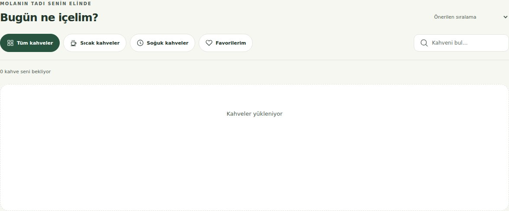
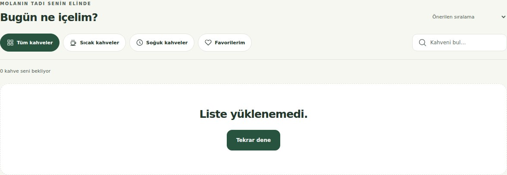
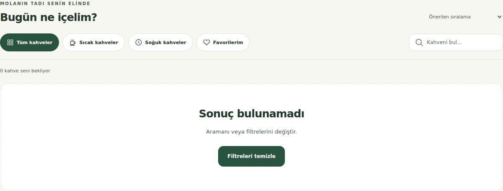
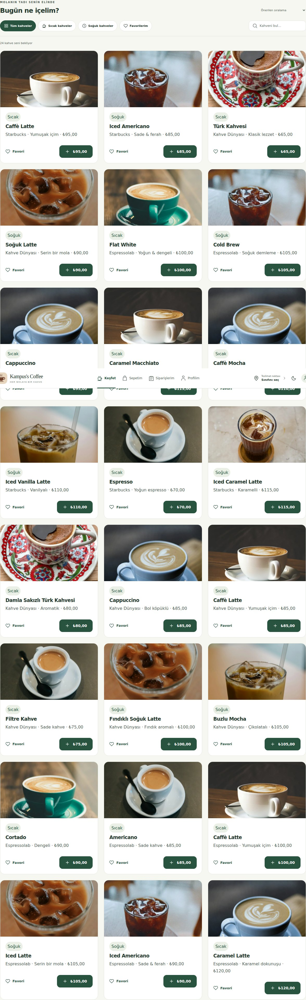

# Görev 13 - Liste durumları
Araç/model: ChatGPT Work, Codex GPT-6. İstem: 4. hafta görevlerini uygula.
Plan: Üç genel durum bileşeni, tek loadList sınırı ve menü/siparişler ekranında dört hal. Mesajları dört dilde merkezileştir.
Düzeltme: Demo hata parametreleri production'da devre dışı; tekrar dene parametreyi tekrar uygulamaz.
Doğrulama: docs/gelistirme-notlari.md adımları; gerçek ekran görüntüleri elde edilirse bu dosyaya eklenir. Öğrencinin elle kontrolü tamamlandı olarak işaretlenmez; otomatik ekran kanıtları aşağıdadır.

## Gerçek ekran kanıtı

Chromium, GitHub Actions [run 40096092271](https://github.com/mertksll/kampus-coffee/actions/runs/40096092271) üzerinde dört hali üretti. Bunlar ajan tarafından otomatik alınmıştır; öğrencinin elle kontrolü olarak işaretlenmez. Orijinal PNG'ler Actions artifact'ında, okunabilir JPEG kopyaları repoda tutulur.

