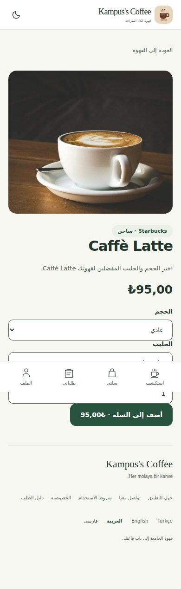

# Görev 14 - Detay ve gezinme
Araç/model: ChatGPT Work, Codex GPT-6. İstem: 4. hafta görevlerini uygula.
Plan: 24 mevcut ürün adresini dört dilde üret, kimliği koru, menü filtrelerini URL ile taşı; bilinmeyen kimlikte 404 göster.
Düzeltme: Ürün bulunamadığında ilk ürüne sessiz dönüş yapılmaz. Ürün adları katalog markasıdır; kontrol ve hata metinleri çevrildi.
Doğrulama: Öğrenci üç ürün, filtreli geri dönüş, yeni pencerede adres ve geçersiz kimliği denemeli. Build raporu ve otomatik gezinme kanıtı batch belgesinde.

## Otomatik gezinme doğrulaması

Chromium testinde kart Enter ile açıldı, filtreli dönüş, doğrudan detay adresi ve olmayan kimlik denetlendi. Dar Arapça detay ekranı: 

